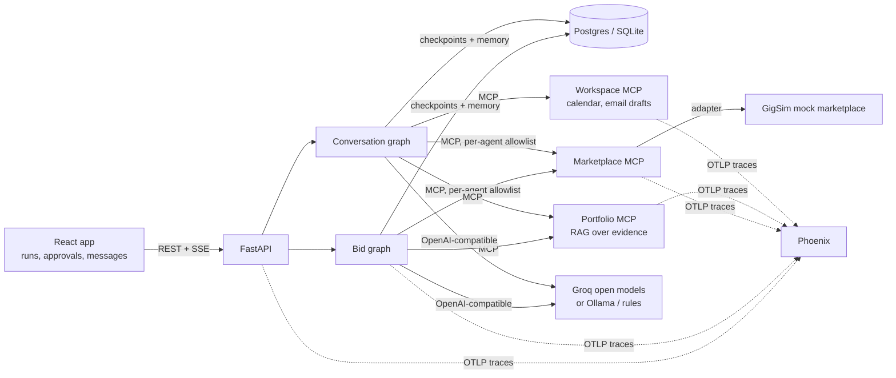

# GigBid: a multi-agent freelancer copilot

GigBid reads freelance job posts, decides which ones are worth bidding on, and drafts evidence-backed
proposals and client replies. **A human approves every proposal and every message before anything is sent.**

It is built from LangGraph agents that reach the marketplace, the freelancer's portfolio, and a calendar
only through MCP servers with least-privilege tool allowlists. A FastAPI + React app streams each agent
run live and handles approvals.

> AI-4016 R&D assignment. Marketplace = **GigSim**, a local mock built from real Kaggle job and price data
> (see [docs/DATA_CARD.md](docs/DATA_CARD.md)). No real proposals are ever submitted.

---

## What it does

| Flow | Agents (graph nodes) | Human step |
|---|---|---|
| **Bid** (one thread per job) | Intake → **Job Analyst ∥ Risk Assessor ∥ Fit Matcher** (parallel) → decide → Pricing Strategist → Proposal Writer → Claim Verifier → Critic (≤2 revisions) → Compliance Guard → dry-run preview | Approve / edit / reject before `submit_proposal` |
| **Conversation** (one thread per client) | Read messages → classify intent → (interview: find calendar slots) → Client Liaison draft → Compliance → dry-run preview | Approve / edit / reject before `send_message` (+ calendar hold) |

- **Evidence-backed writing.** Every experience claim in a proposal must cite an `[evidence_id]` from the portfolio. The Claim Verifier removes unsupported claims before the Critic sees the draft.
- **Long-term memory.** Edits the freelancer makes become *style rules* (only after an explicit promotion rule fires), and proposal outcomes become per-category *outcome memory*.
- **Durable runs.** Pending approvals survive a crash: LangGraph checkpoints in Postgres, idempotency keys on every write, so a resumed run never submits twice. Tested by killing the API mid-run.
- **One trace per user action.** The browser starts a W3C trace, which flows through the API, graph, every LLM call, and into each MCP server process and the audit log (OpenTelemetry → Arize Phoenix), with PII masked before export.

## Architecture



Details: [docs/ARCHITECTURE.md](docs/ARCHITECTURE.md) · design decisions: [docs/adr/](docs/adr/) ·
MCP tools and trust boundaries: [docs/TOOLS.md](docs/TOOLS.md) · security and injection results: [docs/SECURITY.md](docs/SECURITY.md)

## Quick start

**Docker (everything: Postgres, Phoenix, GigSim, API + UI):**

```bash
cp .env.example .env            # add GROQ_API_KEY (free at console.groq.com); APP_USERS=demo:demo123
export BUILDX_BAKE_ENTITLEMENTS_FS=0     # PowerShell: $env:BUILDX_BAKE_ENTITLEMENTS_FS="0"
docker compose -f infra/docker-compose.yml up --build
```

Open http://localhost:8000 (sign in with a login from `APP_USERS`) and http://localhost:6006 for traces.

**Local Python (Windows / macOS / Linux, SQLite persistence):**

```bash
python -m venv .venv && .venv/Scripts/activate      # macOS/Linux: source .venv/bin/activate
pip install -r requirements.txt
cd apps/web && npm ci && npm run build && cd ../..
python -m uvicorn gigsim.app:app --port 8001         # terminal 1: mock marketplace
python -m apps.api.main                              # terminal 2: API + UI on :8000
```

No API key? Set `LLM_PROFILE=fake` and every agent uses its rule-based fallback (offline demo, tests).

## Models

Open-weight models through Groq by default (`agent/config.yaml` → `profiles`), routed by node:
`gpt-oss-20b` for frequent nodes (analyst, verifier, intent), `gpt-oss-120b` for writer, critic and liaison.
`LLM_PROFILE=ollama` runs fully local. Every LLM node has a deterministic rule-based fallback, used on
provider errors (a per-minute rate limit is waited out first). Cost per node is recorded in each trace.

## Evaluation

All runs are reproducible from the repo (`make eval`, or the commands in the [Makefile](Makefile)).
Dev set: 180 labelled jobs, 3 personas, 6 job styles including scams and off-niche jobs.

**Retrieval** (`evals/results/rag_table.md`, gold evidence per job):

| Variant | Recall@5 | MRR | nDCG@10 | p95 ms |
|---|---|---|---|---|
| BM25 | 0.640 | 0.835 | 0.702 | 11 |
| V2 hybrid (BM25 + dense, RRF) | **0.713** | **0.838** | **0.751** | 38 |
| V3 + cross-encoder rerank | 0.659 | 0.812 | 0.714 | 3060 |

**Decisions and simulated outcomes**, full bid graph, 180 jobs, rule-based profile
(`evals/results/outcomes_*_table.md`; GigSim's simulated clients reply based on evidence, skills and openings):

| Retriever | Bid F1 | Scam recall | Wasted bids on skip-jobs | Reply rate |
|---|---|---|---|---|
| **BM25 (deployed)** | **0.916** | 1.00 | **11** | 61.3% |
| V2 hybrid | 0.893 | 1.00 | 21 | 55.8% |

Better retrieval recall did **not** give better decisions: hybrid retrieval finds more loosely related
evidence for off-niche jobs, so it bids on more jobs that should be skipped. The reply-rate gap is not
statistically significant (p = 0.34), so BM25 ships because it is cheaper and simpler with equal outcomes.

**With LLMs** (Groq, 30 jobs, `evals/results/graph_llm_table.md`): bid F1 0.929, 0.67 unsupported claims per
proposal before the Claim Verifier and **0 after**, p50 34 s per job, about 8k tokens per job.

**Prompt injection:** 42 attacks (24 hidden in job posts, 18 in client messages) run against the real graphs
with defences off and on. Results and method: [docs/SECURITY.md](docs/SECURITY.md).

CI runs a 30-job smoke evaluation on every pull request and fails if any threshold in
[evals/thresholds.json](evals/thresholds.json) is missed (bid F1 ≥ 0.88, scam recall ≥ 0.95, 0 unsupported claims after verification, …).

## Tests

```bash
python -m pytest -q          # unit, integration (real graphs + MCP servers in-process), contract snapshots
cd apps/web && npx playwright test   # end-to-end UI
```

Includes: crash/resume exactly-once on Postgres, replay safety, one trace id end to end, PII never reaches
exported spans, MCP tool schema snapshots, duplicate-key detection in config.

## Repository layout

```
agent/          graphs, nodes (one file per agent), prompts, config.yaml, memory, tracing, security
mcp_servers/    marketplace (port + GigSim adapter), portfolio (RAG), workspace (calendar, drafts)
rag/            ingestion, retrievers, variants V0-V4, V8
apps/api/       FastAPI: runs, approvals, conversations, memory, SSE streaming
apps/web/       React + Vite client (typed from the OpenAPI schema), Playwright tests
gigsim/         mock marketplace with simulated clients
evals/          datasets, runners, results, thresholds
infra/          docker-compose, Dockerfiles      render.yaml  free-tier deployment blueprint
```

## Limitations

- The marketplace is a mock. A live Upwork adapter (OAuth) is not implemented.
- Most large-scale numbers use the rule-based profile, because the free LLM tier allows about 200k tokens
  per model per day (a full LLM run of the dev set needs about 1.5M).
- Outcome numbers come from simulated clients, not real ones.
