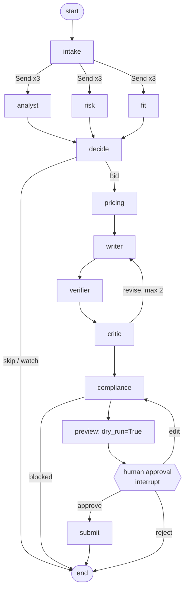

# Architecture

## Components

| Component | Code | Role |
|---|---|---|
| Bid graph | `agent/graphs/bid_graph.py` | One LangGraph thread per job: analyse, decide, price, write, verify, check, wait for approval, submit |
| Conversation graph | `agent/graphs/conversation_graph.py` | One thread per client (`conv-<client_id>`): classify, draft reply / offer slots, check, wait for approval, send |
| Nodes | `agent/nodes/*.py` | One file per agent; prompts in `agent/prompts/*.md`; every rule, model and limit in `agent/config.yaml` |
| LLM access | `agent/llm.py` | One function, `structured()`: typed output (Pydantic), model routed by node, rule-based fallback, token + cost per call |
| Tool access | `agent/mcp_client.py` | `ToolBox.call(agent, tool, ...)`: refuses any tool not in that agent's allowlist; retries on rate limit; passes the trace context |
| MCP servers | `mcp_servers/` | **marketplace** (port + GigSim adapter, rate limit, audit log), **portfolio** (RAG over the freelancer's evidence), **workspace** (calendar holds, email drafts) |
| Persistence | `agent/persistence.py` | `DATABASE_URL` set → Postgres checkpointer + store; otherwise SQLite (Windows dev) |
| Memory | `agent/memory/` | Style memory and outcome memory, written only by explicit promotion rules |
| API | `apps/api/` | FastAPI; `RunManager` runs graphs as background tasks and streams node events over SSE |
| Web | `apps/web/` | React + Vite; API client generated from FastAPI's OpenAPI schema |
| Tracing | `agent/tracing.py` | OpenTelemetry → any OTLP backend (Phoenix in compose); PII masked on export |
| Security | `agent/security.py` | Prompt-injection defence layers (switchable only for the evaluation) |

## Bid graph

- **Parallel analysis.** Job Analyst (LLM → `JobSpec`), Risk Assessor (rules: client quality, scam flags,
  injection flag) and Fit Matcher (portfolio search per requirement → coverage matrix) run at the same time with `Send`.
- **Decision is explainable.** `decide` combines risk level, scam flags, fit score and Connects budget with thresholds from config.
- **Pricing is deterministic.** Market p25/median/p75 for the job's skills, the freelancer's rate, client spend and
  budget caps, then the freelancer's floor. An LLM never sets the price.
- **Writer → Claim Verifier → Critic.** The writer must cite `[evidence_id]` for every claim; the verifier checks each
  claim against the cited text (lexical check + LLM) and removes unsupported ones; the critic checks length, citations,
  generic openings and requirement coverage, and can send the draft back twice. Removed claims are fed back to the writer.
- **Compliance Guard** applies the policy pack (contacts, links, off-platform contact or payment, guarantees) sentence by
  sentence and blocks the draft if too much was removed.

## Conversation graph

`read_messages → classify → (interview_request: slots) → draft_reply → compliance_msg → preview_msg → approve_msg → send_msg`.
Scam signals get a fixed safe reply without an LLM. Negotiation replies may never quote a price below the floor
(Compliance removes such sentences). Answered message ids are stored in the thread, so a message is never answered twice.

## Human approval and exactly-once writes

Approval nodes call `interrupt()` with everything the human needs (draft, evidence, compliance result, dry-run
preview). The run's state is checkpointed; the API resumes it with `Command(resume={action, text, ...})`, even after
a restart. Write tools take an idempotency key derived from the thread id (`<thread>-submit`, `<thread>-<message_id>`),
so a crash between the tool call and the checkpoint re-sends the *same* request and the marketplace returns the
first result. Verified by killing the API container mid-approval: one proposal, Connects charged once.

Checkpoint history is exposed in the UI (`GET /runs/{id}/history`), and any checkpoint can be replayed;
replay never re-runs a write that already happened, for the same idempotency reason.

## Tool access (least privilege)

`config.yaml → tool_allowlist` maps each agent to the tools it may call. The analyst, verifier, critic and
compliance agents have **no** tools. Only `submit` and `liaison_send` can reach a real write, and those nodes are
reachable only after the approval interrupt. Preview nodes force `dry_run=True` in code. The marketplace server
also has its own per-user rate limit and an append-only audit log with the trace id of every call.

## Memory

| Store | Written when | Used by |
|---|---|---|
| `style_candidates` → `style` | A human edit removes a few words or shortens the letter; promoted to a rule after the same pattern appears on 2 different jobs | Writer and Liaison prompts (or applied deterministically in fallback mode) |
| `outcome_events` → `outcome` | Proposal statuses synced from the marketplace; category stats promoted after 3 outcomes | Writer: "what worked before in this category" |

Memory is namespaced per user, can be viewed and deleted from Settings, and is never written directly by an LLM.

## Failure handling

- LLM: per-minute rate limits are waited out; other errors try the fallback model (small nodes) then the node's rule-based
  fallback, so a run always completes. The trace records `fallback_used`.
- MCP: rate-limited calls are retried with backoff; `marketplace_unavailable` puts the run in degraded mode and a paused
  approval simply waits.
- Budgets: max steps per thread (recursion limit), max tokens per thread, max critic revisions.

## Observability

One W3C trace per user action: browser `traceparent` → FastAPI → graph run span → node and LLM spans (model,
tokens, USD cost) → MCP client span → span inside each MCP server process (context sent in the MCP request `_meta`)
→ audit log entry with the same trace id. The run viewer links to the trace. Every span passes through
`agent.pii.mask` before export.
