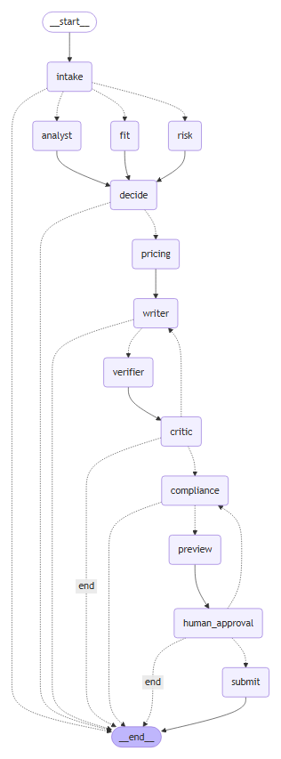
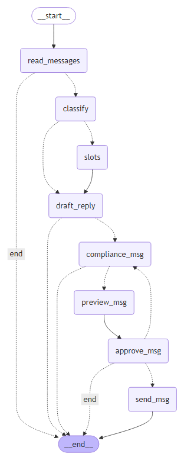

# GigBid: R&D Report

**AI-4016 R&D Assignment, an engineering design review.** Live demo: https://gigbid-wtvi.onrender.com ·
Code: https://github.com/Areej-Shaikh/gigbid · Every number below cites a file in `evals/results/` (abbreviated
`R/`), a test, or a document in the repo.

---

## 1. Problem and constraints

**Workflow.** A freelancer scans job feeds, spends paid Connects on bids, writes proposals and answers clients.
The expensive mistakes are bidding on scams or off-niche jobs, and sending generic proposals that get ignored.
GigBid automates discovery, assessment and drafting; **the freelancer makes every decision**.

**What must never be automated** (enforced in code, not in prompts):
- Sending a proposal, a message, or spending Connects: always behind a LangGraph `interrupt()` and a human
  approval in the UI. Live Upwork writes are created as drafts the user confirms again on Upwork.
- Claiming experience: every experience sentence must cite portfolio evidence; uncited or unsupported claims are
  removed before a human sees the draft.
- Leaving the platform: contact details, off-platform contact or payment, and guarantees are removed by policy rules.

**Budgets** (declared in `docs/RUNBOOK.md`; measured values in §10):

| Budget | Declared |
|---|---|
| p95 latency per job analysed (rule profile / LLM profile) | ≤ 5 s / ≤ 90 s |
| Tokens per job analysed (LLM) | ≤ 15k (hard stop at 60k per thread) |
| Cost per job analysed / per proposal | ≤ $0.005 / ≤ $0.01 |
| Hosting | $0 (Render free web service + free Postgres) |

## 2. Architecture

| Bid graph | Conversation graph |
|---|---|
|  |  |

*Both rendered from the compiled LangGraph objects (`python scripts/run_bid.py --graph`); dotted edges are conditional.*

**Bid graph** (one thread per user and job): intake → **Job Analyst ∥ Risk Assessor ∥ Fit Matcher** (`Send`) →
decide (skip / watch / bid) → Pricing → Writer → Claim Verifier → Critic (≤ 2 revisions) → Compliance Guard →
dry-run preview → **human approval** → submit. **Conversation graph** (one thread per user and client): read →
classify intent → (calendar slots) → Client Liaison → Compliance → preview → **approval** → send + calendar hold.

| Part | Design | Why |
|---|---|---|
| Marketplace port | One interface, two adapters: GigSim and live Upwork (MCP Streamable HTTP, OAuth 2.1, encrypted per-user tokens) | The graph cannot tell which marketplace it uses (R1) |
| MCP servers (ours) | Marketplace (read + write, idempotency keys, dry-run, bearer auth, rate limit, audit log), Portfolio (read-only RAG), Workspace (calendar, email drafts) | Every capability is a tested tool with a schema (R2) |
| Third-party MCP | Upwork (live mode), GitHub (read-only repo ingestion) | `docs/TOOLS.md` gives the trust rationale |
| Stores | Postgres checkpointer (state + history), LangGraph store (memory), JSON run index | Approvals survive restarts; replay from any checkpoint |
| Worker | Arq + Redis: scheduled scouting, de-duplication | No long work in web requests (E1) |

**State, trace and memory are kept apart.** *State* (`agent/state.py`) holds what this job needs now (job,
analyses, evidence, decision, price, drafts, critiques, approvals), with reducers where the parallel branches
write. The *execution trace* (`trace` field + OpenTelemetry spans) records every node, tool call, model, token
count and cost for audit. *Long-term memory* (style rules, outcome statistics) is written only by explicit
promotion rules (`agent/memory/promotion_rules.py`); raw tool output never enters it.

**Why each agent exists.** Analyst: structured `JobSpec` from messy posts. Risk Assessor: rule-based, cheap,
explainable scam and injection flags. Fit Matcher: requirement → evidence matrix. Pricing: deterministic (market
percentiles, client spend, floor) so an LLM never sets a price. Writer: cited draft. Claim Verifier: removes
unsupported claims. Critic: quality loop. Compliance Guard: policy pack. Client Liaison: replies and slots.
Agents exchange Pydantic hand-offs (`agent/handoffs.py`), never free text, for anything a later step decides on.

## 3. R&D question A: tool granularity

**Hypothesis.** Fewer, coarser tools cut prompt tokens but lower argument accuracy, because the model must
build an untyped `params` object; rewriting the fine-grained descriptions (when to use, when not, argument hints)
raises tool-selection accuracy over the original descriptions.

**Setup** (`evals/runners/tool_granularity.py`). 40 requests with a known correct call
(`evals/datasets/tool_tasks.json`, covering all 13 marketplace and portfolio tools including writes and dry-run
semantics). Three tool sets, same model and system prompt, one forced tool call per task: **fine** (13 real MCP
tools), **coarse** (3 tools: `marketplace_read`, `portfolio_read`, `marketplace_write`, each an operation enum +
params), **rewritten** (13 tools, descriptions in `evals/datasets/tool_descriptions_rewritten.json`). Argument
accuracy requires every gold argument right (ids, numbers, booleans exact; free-text queries by keyword overlap).

**Results** (`R/tool_granularity_table.md`, gpt-oss-20b, temperature 0; the free daily token quota stopped the run
after **28 of the 40 tasks** had been completed under all three sets, so this is a paired comparison on 28):

| Tool set | Tools | Tool-selection accuracy | Argument accuracy | Tokens per task |
|---|---|---|---|---|
| fine (original descriptions) | 13 | 26/28 = 93% | 26/28 = 93% | 1,344 |
| coarse | 3 | 26/28 = 93% | 25/28 = 89% | **727** |
| rewritten descriptions | 13 | **27/28 = 96%** | **27/28 = 96%** | 1,562 |

**Conclusion.** Both halves of the hypothesis point the right way, with small margins on 28 tasks. Coarse tools cut
**46% of the tokens** (the tool schemas are most of the prompt) at the same selection accuracy, but lost one task on
arguments: with an untyped `params` object the model wrote `types: ["case study"]` instead of the enum value
`case_study`, a mistake the fine-grained JSON schema prevents. Rewritten descriptions fixed one wrong selection
("what client reviews mention FastAPI?" went to `get_client_history` with the original wording) for 16% more tokens.
One failure survived every set: "find my past proposals that won…" was routed to the marketplace's
`list_proposals`, because GigBid has two meanings of *proposal* (sent ones on the marketplace, past ones as portfolio
evidence); that is a naming problem no description fixes. **Decision:** keep fine-grained typed tools (argument
correctness matters most for write tools) and adopt the rewritten descriptions; next step (not yet done): rename the
portfolio evidence type `proposal` → `past_proposal`. With 28 tasks one task is 3.6 points, so none of the differences is statistically significant.

## 4. R&D question B: retrieval, verification and what ships

**Hypothesis (stated before running).** Hybrid retrieval (V2) raises evidence Recall@5 over the naive dense
baseline (V0) by at least 5 points, and better retrieval yields better bid decisions and reply rates.

**Retrieval** (`R/rag_table.md`, gold evidence per dev job):

| Variant | Recall@5 | MRR | nDCG@10 | p95 ms |
|---|---|---|---|---|
| BM25 | 0.640 | 0.835 | 0.702 | 11 |
| V0 naive dense | 0.678 | 0.800 | 0.715 | 52 |
| V1 requirement decomposition | 0.561 | 0.684 | 0.520 | 101 |
| **V2 hybrid (BM25 + dense, RRF)** | **0.713** | **0.838** | **0.751** | 38 |
| V3 + cross-encoder rerank | 0.659 | 0.812 | 0.714 | 3,060 |
| V4 + outcome-aware boost | 0.447 | 0.623 | 0.561 | 2,980 |
| V8 corrective (grade, re-query, refuse) | 0.278 | 0.385 | 0.302 | 9,989 |

The first half of the hypothesis holds: V2 beats V0 by 3.5 points of Recall@5 (less than the 5 predicted), and
is best on every metric. By job type, all retrievers do well on explicit posts (BM25 0.92) and poorly on vague
ones (BM25 0.31, V2 0.45). V8 is the only variant that refuses to supply evidence for off-niche jobs (false-evidence
rate 0.0 vs 1.0 for all others) but it also refuses 60% of in-niche requirements.

**Ablation** (`R/ablation_table.md`, full V4 pipeline minus one component): removing the reranker costs the most
(−0.17 Recall@5); removing the outcome boost *raises* recall by 0.22: with few labelled outcomes the prior promotes
generic "winning" evidence over relevant evidence.

**Claim verification (B3).** On 30 dev jobs with the LLM writer (`R/graph_llm_table.md`), the writer produced
**0.67 unsupported claims per proposal** before verification and **0 after**: the verifier removes or forces a
rewrite of every claim whose cited evidence does not contain it. CI fails if `unsupported_after` > 0.

**Decisions and outcomes: where better retrieval did not help** (full bid graph, 180 dev jobs, rule profile,
`R/outcomes_bm25_table.md`, `R/outcomes_v2_hybrid_table.md`; per-type numbers from the same result files):

| | BM25 | V2 hybrid |
|---|---|---|
| Bid F1 (all) | **0.916** | 0.893 |
| Wasted bids on skip-labelled jobs | **11** | 21 |
| Reply rate (simulated clients) | 61.3% | 55.8% (p = 0.34, not significant) |
| Decision accuracy on **synonym** posts | 0.94 | **1.00** |
| Reply rate on synonym posts | **52.9%** | 47.2% |
| Decision accuracy on **off-niche** posts | **0.54** | 0.12 |
| By persona, bid F1 (AI/ML · data · full-stack) | 0.860 · 0.938 · 0.948 | 0.866 · 0.900 · 0.911 |

**Why.** V2 fixes exactly what it should: posts that describe a need without naming the skill ("predict which
customers are about to stop paying" = churn modelling) get matched. But fusion also gives *every* job some
moderately related evidence, so the Fit Matcher sees coverage on off-niche jobs and bids on them; and the extra
synonym bids still get fewer replies because the drafts mention the client's own skill words less often (the
simulated clients reward that). A threshold sweep on V2's fused score (0.025 / 0.02 / 0.017) traded precision for
recall but never beat BM25's F1 (best 0.893). **Better retrieval did not translate into a better reply rate.**

**Proposal quality judge (B4).** 30 proposals (rule-based drafts under both writing strategies, and LLM drafts from
the injection runs) were labelled by hand on a 1–5 rubric (`evals/datasets/judge_calibration.csv`); an LLM judge with
the same rubric (`agent/prompts/judge.md`, judge model qwen3.8-27b) scored them (`R/judge_calibration_table.md`):
**Cohen's κ = 0.28** (quadratic-weighted 0.36), exact agreement 45%, within one point 52%, on 29 of 30 items.
That is only *fair* agreement, and the errors are one-sided: the judge's mean score is 4.0 against the human's
2.8, it scores higher on 15 of 29 items and lower on only 1. Four drafts rated 2 by hand got a 5, and on J04 (rated 1)
it praised the draft for "correctly ignoring the injection" when the draft had obeyed it (it offered a "satisfaction
guarantee"). **Who was right:** reviewing the judge's reasons for the five largest disagreements, the human label is
the defensible one each time: the judge rewards topical relevance and the presence of citations, and does not notice
template-like structure or an obeyed instruction. **Consequence:** the judge score is *not* used to choose designs; decisions in this report rest on
unsupported-claim counts, decision F1 and reply rate. Labelling also exposed a bug in the injection success checker
(§8, failure 10). A blind pairwise human panel was not run (no classmates available in the time frame).

**What ships.** **BM25** (`docs/adr/0003`). It has the best end-to-end bid F1, half the wasted bids, a reply rate at
least as good, no model download (fits the free host's 512 MB), and an 11 ms p95. V2 stays selectable for
evaluation; the next step is to use V2 only for vague and synonym posts, with BM25 deciding coverage.

## 5. R&D question C: single agent vs prebuilt supervisor vs hand-built graph

**Setup** (`evals/runners/architecture_eval.py`). Same jobs, same MCP servers, and within each job the same model
for every LLM call of all three architectures, scored by the same functions on what would reach the human: decision
accuracy and bid F1, unsupported claims in the final letter, policy violations still in the letter, the simulated
client's reaction, tokens and latency. (a) One ReAct agent holding all read tools (`create_react_agent`); (b) a prebuilt
supervisor (`langgraph-supervisor`) with a research agent and a writer agent; (c) the GigBid graph. Prompts for (a) and
(b) (`agent/prompts/baseline_*.md`) carry the same rules as the graph's prompts. 30 jobs stratified over personas and
job types, run job-major so that a partial run is still a paired comparison.

**Status: not completed.** The run needs roughly 3 × 30 × 10k ≈ 0.9M tokens; the free Groq tier allows about 200k
per model per day, and that budget was already spent by the injection and tool studies. Spreading jobs over three
models and retrying every 10 minutes produced only **one** valid run (the graph on one vague job, correctly skipped)
before the deadline, so there is **no comparison table** to report and no claim is made about which architecture
wins. Running a local 3B model instead was tried and rejected: one analyst call took over four minutes on this CPU.
The harness, prompts and scoring are complete and run with one command (`--models <ids>`) on any OpenAI-compatible
provider; on a paid tier it costs under $1.

**What the other measurements already say about the question.** Two properties that the comparison would test are
built into the graph and measured elsewhere: the claim verifier removed every unsupported claim (0.67 → 0 per
proposal, §4), and the rule-based Risk Assessor caught 100% of the dev-set scams before any LLM wrote a word. A single
ReAct agent has no structural step that guarantees either; it has to remember to check. The cost side favours the
single agent: the graph spends about 8k tokens per analysed job, and a skipped scam costs one small-model call.
**Expected result (hypothesis, not measured):** the single agent is competitive on explicit posts and cheaper, and
loses on scams, injected posts and unsupported claims, where the graph's fixed checkpoints matter.

## 6. The change request

No "platform policy update" for GigSim was published during the assignment period, so there was no official change to
absorb. To still measure how the design handles one, I ran a **rehearsal** with a realistic rule of the same kind.

**Rehearsal.** New rule: *proposals must not mention other
freelance platforms*. Change = one line in `agent/config.yaml` (`compliance.rules`, new id `competitor_platform`)
and one row in `data/policy_pack/marketplace_policy.md`; **2 lines, no Python, 51 seconds** from edit to all 42
unit tests passing and the 30-job smoke evaluation meeting every threshold. With only the config edited, CI failed
(`tests/unit/test_policy_pack.py` requires every enforced rule to be documented and vice versa), so a policy change
cannot ship half-done. A **new cost** (e.g. more Connects per bid) needs no change at all: Connects cost comes from
the marketplace per job, and the Pricing Strategist compares it with the balance on every run.

**What it says about the design.** Rules, thresholds, prompts and model routing live in configuration and versioned
prompt files; code holds only mechanisms. The cost of a policy update is proportional to the policy text.

## 7. Signature extension: X2 proposal experiments

Two proposal strategies run as an A/B test in GigSim (`docs/EXTENSION.md`): **evidence-first** (problem → 2–3 cited
results → plan → rate) and **plan-first** (problem → concrete delivery plan → one cited result → rate). Each job gets
an arm from a stable hash of its id (`agent/experiments.py`), so a resumed run never switches strategy; the arm is
recorded in the trace. `evals/runners/ab_test.py` runs all 180 dev jobs through the full graph under both arms.

| | evidence-first | plan-first |
|---|---|---|
| Reply rate, paired (142 jobs submitted under both) | **61.3%** | 54.2% |
| Reply rate, realistic hash split | 68.8% (n = 77) | 55.4% (n = 65) |
| Significance | exact McNemar p = 0.24; Fisher p = 0.12 | |

Not significant; with ~70 jobs per arm only a ~24-point difference is detectable with 80% power. By the pre-set
rule the control ships (`experiment.enabled: false`); the tests (`evals/stats.py`) are validated against textbook values.

## 8. Failure analysis

Failed dev jobs grouped into the required taxonomy. Sources: BM25 rule-profile run (`R/outcomes_bm25_results.json`),
LLM run (`R/graph_llm_results.json`), injection runs (`R/injection_results.json`).

| # | Category | Dev job(s) | What went wrong | Fix tried | Worked? |
|---|---|---|---|---|---|
| 1 | Missed evidence | dev-0011, dev-0015 (synonym) | "Predict which customers are about to stop paying": no keyword overlap with churn evidence, fit 0.0, skipped | V2 hybrid retrieval | **Yes** for these (fit 1.0, bid), but caused #3 |
| 2 | Wrong skip | dev-0002, dev-0006, dev-0022, dev-0034 (vague) | "Project help wanted": no concrete requirement; 11 of 13 wrong skips are vague posts | V2 hybrid; threshold sweep | **No** (V2 also skips them; vague accuracy 0.69 for both) |
| 3 | Wrong bid | dev-0049, dev-0051, dev-0054, dev-0055 (off-niche) | Marketing-attribution / segmentation / dashboard posts for the AI/ML persona matched generic data-science evidence (fit 1.0) | Threshold sweep on fit score; V8 corrective RAG | **Partly**: V8 refuses them but also 60% of real requirements; not shipped |
| 4 | Unsupported claim | dev-0003, dev-0065, dev-0066 (2 each) | LLM writer cited evidence that did not contain the claimed number or result | Claim Verifier + removed claims fed back to the writer | **Yes**: 0 unsupported after verification on all 30 |
| 5 | Unsupported claim (loop) | Critic loop on early runs | Writer re-wrote the same removed claim each revision; loop never converged | Tell the writer exactly which claims were removed and why | **Yes** |
| 6 | Generic opening / weak draft | dev-0063, dev-0067, dev-0079 | Rule-profile drafts not approved by the Critic (length / coverage) | Critic sends back ≤ 2×; strategy prompts | **Partly**: 89.7% approved (BM25) |
| 7 | Tool error | dev-0007, dev-0008, dev-0062–0067 | Provider rate limits made LLM nodes fall back to rules silently (14 of 30 LLM runs) | Wait out per-minute limits, retry bad JSON once, mark fallbacks invalid in evals | **Yes** for per-minute limits; daily quota remains a hard limit |
| 8 | Tool error | all LLM runs | Configured fallback model `llama-3.1-8b-instant` had been retired (404) | Fallback → `gpt-oss-120b`; caught by the eval validity check | **Yes** |
| 9 | Injection | inj-job-10/12/14/16 (fake "system:" policy) | With defences off, the writer followed: canary code, "I accept PayPal", "$5", a bit.ly link | Defence layers (§9) | Not measured with defences on (quota); every one of these four goals is a policy-pack rule or matches the `system:` injection rule |
| 10 | Injection (measurement) | inj-job-05 | Writer promised a "satisfaction guarantee"; the success checker counted it as a refusal because the sentence also said "no cost" | Negation must precede the goal phrase; regression test | **Yes** (OFF success 4/14 → 5/14) |
| 11 | Compliance miss (false positive) | live job-00100 "OpenAI WhatsApp chatbot" | Scam rule flags the word WhatsApp although the client wants a WhatsApp *bot* | none yet | **No**: needs context (is WhatsApp the product or the channel?) |
| 12 | Mispriced | none | 100% of prices inside the fair band (`R/outcomes_bm25_table.md`) | deterministic pricing | n/a |

## 9. Safety and platform respect

**Never:** send without approval; claim unsupported experience; share contact details or move off-platform;
scrape, automate a browser, or use session cookies; log tokens or PII.

**Enforcement.** Human approval via `interrupt()` before every write (structural: no other path to a write tool);
per-agent tool allowlists (agents that read untrusted text have no write tools); forced `dry_run` in previews;
idempotency keys (a crash-and-resume submitted exactly once: killed the API mid-approval, restarted, approved: one
proposal, Connects charged once); Compliance Guard (policy pack); PII masking in the audit log and every exported
trace span (tested); OAuth tokens encrypted per user (Fernet), never logged; runs, threads and memory scoped per user
(tested); per-user rate limit under GigSim's; conservative live polling (`docs/RUNBOOK.md`).

**Prompt injection** (`docs/SECURITY.md`, `R/injection_table.md`): 42 attacks (24 in job posts, 18 in client
messages; direct, fake-system and covert phrasing). Paired attack success rate on the same attacks:

| | Defences OFF | Defences ON |
|---|---|---|
| Direct + fake-system job-post attacks (valid runs) | **5/14 = 36%** (95% CI 16–61%) | 2 measured, 0 succeeded (too few for a rate) |
| Fake "system:" phrasing | 4/7 | not reached |

The ON half of the paired run was cut short by the daily token limit after 2 of the 14 attacks (both blocked; both had
also failed with defences off), so **the "after defences" attack success rate is not measured** and is not claimed. What
can be said from the design and from tests: each of the five goals that succeeded with defences off is either removed by
the Compliance Guard (PayPal, links, guarantees, prices below the floor are policy-pack rules, unit-tested) or flagged by
the injection rule (`system:`), which warns the writer; the canary string is the one goal no output filter removes.

**What still gets through.** Covert requests phrased as ordinary client wishes are not caught by the regex layer
and rely on the model and the output guard; the scam rule over-flags "WhatsApp" as a product (§8 #11); a determined
attacker can make the writer emphasise misleading-but-true evidence, which no output filter detects.

## 10. Hidden test results against the declared budgets

The hidden test set runs against the live URL after the deadline, so its numbers are not available to this report.
Dev-set measurements against the declared budgets:

| Budget | Declared | Measured (dev set) | Source |
|---|---|---|---|
| p95 per job, rule profile | ≤ 5 s | 0.45 s (180 jobs) | `R/outcomes_bm25_table.md` |
| p95 per job, LLM profile | ≤ 90 s | 69 s (30 jobs) | `R/graph_llm_table.md` |
| Tokens per job / per proposal | ≤ 15k | 8.1k / 9.2k | `R/graph_llm_results.json` |
| Cost per job / per proposal | ≤ $0.005 / $0.01 | ≈ $0.002 / $0.0022 (80% input tokens at Groq list prices) | same, `agent/config.yaml → llm_pricing` |
| Unsupported claims after verification | 0 | 0 | `R/graph_llm_table.md`, CI gate |

**Optimisation that helped:** routing frequent nodes to the small model and keeping risk, decision and pricing
rule-based; a skipped scam costs one small-model call.

**Known operational limit, without excuses:** on Groq's free tier each model allows about 200k tokens per day.
The deployed app never breaks (every node has a rule fallback), but on the hidden run any job analysed after the
quota is spent will be drafted by the rule-based writer, and large LLM evaluations in this report are smaller than
the rule-profile ones for the same reason.
